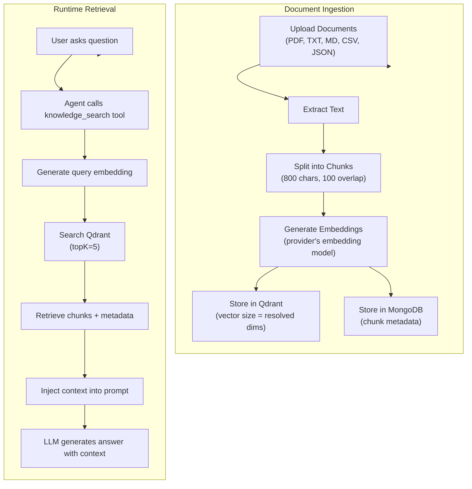

# Knowledge Module

## Purpose

Implements **Retrieval-Augmented Generation (RAG)** capabilities. Users can create knowledge bases, upload documents, and attach them to agents so they can semantically search the content during conversations.

## Location

`src/modules/knowledge/`

## Structure

```
src/modules/knowledge/
├── index.js                       # Barrel exports
├── knowledge.routes.js            # REST API routes
├── knowledge.controller.js        # HTTP handlers
├── knowledge.service.js           # Business logic
├── knowledge.repository.js        # Database access
├── knowledge-base.model.js        # KnowledgeBase Mongoose schema
├── knowledge-chunk.model.js       # KnowledgeChunk Mongoose schema
├── knowledge.validator.js         # Zod validation schemas
└── knowledge.tools.js             # LangChain RAG tools for agents
```

## Responsibilities

- CRUD operations for knowledge bases
- Document upload and ingestion (PDF, TXT, MD, JSON, CSV)
- Document chunking and vector embedding
- Vector storage in Qdrant
- Semantic search across knowledge bases
- Tool generation for agents (semantic search + list sources)

## RAG Flow



## Data Models

### KnowledgeBase

| Field                  | Type                  | Description                  |
| ---------------------- | --------------------- | ---------------------------- |
| `name`                 | String (200)          | Knowledge base name          |
| `description`          | String (1000)         | KB description               |
| `ownerId`              | ObjectId (User)       | KB owner                     |
| `isPublic`             | Boolean               | Public visibility flag       |
| `documentCount`        | Number                | Number of uploaded documents |
| `chunkCount`           | Number                | Total chunk count            |
| `qdrantCollectionName` | String (unique)       | Qdrant collection identifier |
| `documents`            | [Document]            | Document manifest            |
| `embeddingModel`       | String                | Embedding model name         |
| `embeddingDimensions`  | Number                | Resolved vector size (probed)|
| `providerId`           | ObjectId (Provider)   | Embedding provider           |
| `chunkSize`            | Number (default: 800) | Chunk size in characters     |
| `chunkOverlap`         | Number (default: 100) | Chunk overlap                |
| `topK`                 | Number (default: 5)   | Results per search           |

### KnowledgeChunk

| Field             | Type     | Description          |
| ----------------- | -------- | -------------------- |
| `knowledgeBaseId` | ObjectId | Parent KB            |
| `sourceName`      | String   | Source document name |
| `chunkIndex`      | Number   | Position in document |
| `content`         | String   | Chunk text content   |
| `vectorId`        | String   | Qdrant point ID      |

## Supported File Types

| Type     | Extension | MIME Type          |
| -------- | --------- | ------------------ |
| PDF      | `.pdf`    | `application/pdf`  |
| Text     | `.txt`    | `text/plain`       |
| Markdown | `.md`     | `text/markdown`    |
| CSV      | `.csv`    | `text/csv`         |
| JSON     | `.json`   | `application/json` |

## Embedding Providers

Embeddings are generated through the Knowledge Base's `providerId`. Every
supported provider speaks the OpenAI `/v1/embeddings` shape, so one client
(`OpenAIEmbeddings`) covers all of them — only the Base URL and key differ.

| Provider type | Embeddings | Notes |
| ------------- | ---------- | ----- |
| `openai` | Yes | `text-embedding-3-small` (1536), `text-embedding-3-large` (3072), `text-embedding-ada-002` (1536) |
| `deepseek` | Yes | Any OpenAI-compatible embedding model exposed by the account |
| `ollama` | Yes | Local; preset Base URL `http://localhost:11434/v1`. `apiKey` is optional and defaults to the placeholder `ollama` |
| `custom` | Yes | Any OpenAI-compatible host (LM Studio, vLLM, LocalAI, …) |
| `anthropic` | **No** | Rejected at creation with `UNSUPPORTED_EMBEDDING_PROVIDER` |
| `gemini` | **No** | Rejected at creation with `UNSUPPORTED_EMBEDDING_PROVIDER` |

### Dimensionality

`embeddingDimensions` is resolved at creation time by probing the provider
with a one-token `embedQuery('dimension probe')`, and that exact number
becomes the Qdrant collection's `size`. The probe is authoritative — it
catches a model name that the provider does not actually serve, an
unreachable host, and MRL truncation that the provider silently ignores.

Static fallbacks live in `knowledge.constants.js`
(`EMBEDDING_MODEL_DIMENSIONS`), used when a legacy Knowledge Base has no
stored dimensions or when the probe fails during an update.

Matryoshka (MRL) models can be truncated by sending an explicit
`embeddingDimensions` — e.g. `embeddinggemma-2` at `512` instead of its
native `768`:

| Model | Native | Supported MRL values |
| ----- | ------ | -------------------- |
| `text-embedding-3-small` | 1536 | 256 / 512 / 1024 / 1536 |
| `text-embedding-3-large` | 3072 | 256 / 512 / 1024 / 3072 |
| `embeddinggemma-2` | 768 | 128 / 256 / 512 / 768 |

`embeddingModel`, `providerId` and `embeddingDimensions` are fixed once a
Knowledge Base has indexed documents (HTTP 409
`KB_EMBEDDING_CONFIG_IMMUTABLE`). On an empty Knowledge Base they can still
be changed, and the (empty) collection is recreated with the new size.

### Local Qdrant

`QDRANT_API_KEY` is optional — a self-hosted Qdrant has no auth by default:

```bash
docker run -d --name persona-qdrant \
  -p 6333:6333 -p 6334:6334 \
  -v persona_qdrant_storage:/qdrant/storage \
  qdrant/qdrant
```

```env
QDRANT_URL=http://localhost:6333
QDRANT_API_KEY=
```

## Public API

| Method   | Path                                          | Auth     | Purpose               |
| -------- | --------------------------------------------- | -------- | --------------------- |
| `POST`   | `/api/v1/knowledge`                           | Required | Create knowledge base |
| `GET`    | `/api/v1/knowledge`                           | Required | List knowledge bases  |
| `GET`    | `/api/v1/knowledge/:id`                       | Required | Get KB details        |
| `PATCH`  | `/api/v1/knowledge/:id`                       | Required | Update KB             |
| `DELETE` | `/api/v1/knowledge/:id`                       | Required | Delete KB             |
| `POST`   | `/api/v1/knowledge/:id/upload`                | Required | Upload documents      |
| `GET`    | `/api/v1/knowledge/:id/documents`             | Required | List documents        |
| `DELETE` | `/api/v1/knowledge/:id/documents/:sourceName` | Required | Delete a document     |
| `POST`   | `/api/v1/knowledge/:id/search`                | Required | Search KB             |

## Agent Tools

When an agent has knowledge bases attached, two tools are provided:

1. **`knowledge_search`** — Semantic search across the knowledge base. Takes a query string, returns relevant chunks with source attribution.
2. **`list_knowledge_sources`** — Lists all document sources in the KB with metadata.

## Dependencies

| Dependency  | Type     | Purpose                   |
| ----------- | -------- | ------------------------- |
| Auth module | Internal | Authentication middleware |
| Providers module | Internal | Embedding provider + key resolution |
| Qdrant      | External | Vector storage and search |
| Embeddings provider | External | Text embeddings (OpenAI / DeepSeek / Ollama / custom, OpenAI-compatible) |
| Multer      | External | File upload handling      |
| PDF-Parse   | External | PDF text extraction       |

## Important Business Rules

### Ingestion Pipeline

1. Files are uploaded via multer (in-memory storage, 20MB limit, max 10 files)
2. Text is extracted from each file type
3. Text is split into chunks (configurable size/overlap, default 800/100)
4. Each chunk is embedded with the Knowledge Base's `embeddingModel` through its `providerId`
5. Embeddings stored in Qdrant, metadata in MongoDB
6. Chunk metadata is only persisted **after** the Qdrant upsert succeeds

### Creation Order

1. Resolve the provider and validate it exposes embeddings
2. Resolve `embeddingModel` (request → provider default for Ollama → `KNOWLEDGE_EMBEDDING_MODEL`)
3. Probe the provider for the effective dimensionality
4. Insert the Mongo record (placeholder collection name)
5. Create the Qdrant collection with that exact size
6. Persist the real collection name and delete the temp collection

A failure in step 3 never leaves an orphaned Knowledge Base row; a failure
in step 5 deletes the placeholder row it just created.

### Search Parameters

- `topK`: Number of chunks to return (configurable per KB, default 5)
- Results include source document name, chunk content, and the Qdrant similarity score
  (`similaritySearchWithScore`, so callers can threshold on relevance)

### Cleanup

When a knowledge base is deleted, both the Qdrant collection and MongoDB records are cleaned up.
