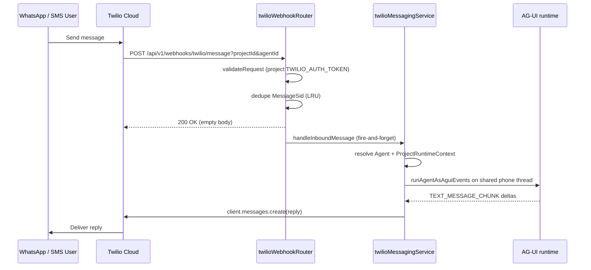

# Twilio Module

## Purpose

Bridges traditional telephone calls (PSTN / mobile telephony) **and** SMS / WhatsApp messaging to AI agents running on the platform.

- **Voice:** receives inbound phone calls via Twilio Voice webhooks, initiates outbound calls, and streams bidirectional audio between Twilio Media Streams (8kHz μ-law) and Gemini Live (16kHz/24kHz linear PCM).
- **Messaging:** receives inbound SMS and WhatsApp messages, runs the text agent on a conversation thread shared with voice for the same phone number, and delivers the reply out-of-band through the Twilio REST API. Also exposes Project-Admin endpoints for plain and agent-composed outbound messages.

## Location

`src/modules/twilio/`

## Structure

```
src/modules/twilio/
├── index.js                    # Barrel exports
├── twilio.service.js           # TwiML, outbound calls, secret resolution, messaging helpers + sendMessage
├── twilio.controller.js        # Voice, message, status, and outbound HTTP handlers
├── twilio.routes.js            # /api/v1/webhooks/twilio routes + /api/v1/twilio/call
├── twilioMessaging.service.js  # Inbound SMS/WhatsApp pipeline + agent-composed outbound
├── twilioMessaging.routes.js   # /api/v1/projects/{projectId}/twilio routes
├── developerMessaging.routes.js # /api/v1/developer/messages routes (Project credential)
├── audioConverter.js           # Bidirectional μ-law 8kHz <-> Linear PCM 16/24kHz transcoding
├── TwilioVoiceTransport.js     # EventEmitter adapter bridging Twilio WS to VoiceSession
└── twilioGateway.js            # HTTP Upgrade handler on /api/v1/twilio/media-stream
```

## Responsibilities

### Voice

- **Telephony Webhook Ingestion**: Receives Twilio Voice call events (`POST /api/v1/webhooks/twilio/voice`) and generates TwiML `<Connect><Stream>` instructions to establish Media Stream WebSockets.
- **Outbound Voice Calling**: Triggers automated agent phone calls via the Twilio REST API using multi-tenant credentials resolved per-project.
- **Audio Transcoding**: Converts 8kHz μ-law audio packets from Twilio into 16kHz linear PCM for Gemini, and resamples 24kHz Gemini output to 8kHz μ-law with proper byte chunking (160 bytes per 20ms frame).
- **Smooth Audio Pacing & Jitter Smoothing**: Uses a 20ms pacing queue with an adaptive high-water mark (`MAX_OUTBOUND_QUEUE_CHUNKS = 250`) to buffer audio smoothly and drop stale chunks during congestion.
- **Telephony Barge-In Clearing**: Immediately clears Twilio's remote playback buffer upon receiving a `voice_interrupted` event by transmitting a Twilio `{ event: 'clear' }` packet.
- **Thread & Context Continuity**: Tracks external users by phone number (`externalUserService.resolveOrCreate`), establishes persistent conversation threads (`agui-${domain}-${agentId}-${callerPhone}`), and injects caller phone and `callSid` into agent `turnContext`.

### Messaging

- **Inbound SMS / WhatsApp**: `POST /api/v1/webhooks/twilio/message` validates `X-Twilio-Signature`, deduplicates retried `MessageSid`s in an LRU, and acknowledges with an empty `200` **before** running the agent — Twilio retries non-2xx webhooks, and an agent turn is slower than the webhook timeout.
- **Shared conversation identity**: each phone number maps to the same `agui-${projectId}-${agentId}-${phone}` LangGraph thread used by voice, and to a `ProjectRuntimeContext` whose `externalUserId` is the normalized E.164 number. Per-conversation turns are serialized through an in-memory promise queue so checkpoint writes cannot interleave.
- **Channel-aware delivery**: replies go back over the channel the message arrived on (`whatsapp:` prefix → WhatsApp, otherwise SMS). Markdown is stripped, and long bodies are split under Twilio's limits (1500 chars for SMS, 4000 for WhatsApp).
- **Guarded-tool refusal**: an Agent with any `interruptOn` tool enabled is refused on messaging channels (same parity as voice — there is no approval flow), and the sender gets a generic unavailable reply.
- **Loop guard**: `sendMessage` refuses to address the Project's own sender number, preventing an agent reply loop from becoming an unbounded message ping-pong.
- **Status callbacks**: `POST /api/v1/webhooks/twilio/message-status` logs delivery state (`queued`, `sent`, `delivered`, `failed`) and returns `204`.

## Request Flow — Inbound Message



## Public API & Endpoints

| Method     | Path                                                 | Auth                      | Purpose                                                                    |
| ---------- | ---------------------------------------------------- | ------------------------- | -------------------------------------------------------------------------- |
| `POST`     | `/api/v1/webhooks/twilio/voice`                      | Public (Twilio Signature) | Inbound call webhook; returns TwiML with `<Stream>` configuration          |
| `POST`     | `/api/v1/webhooks/twilio/status`                     | Public (Twilio Signature) | Call progress/status tracking webhook (ringing, answered, completed)       |
| `POST`     | `/api/v1/webhooks/twilio/message`                    | Public (Twilio Signature) | Inbound SMS / WhatsApp message; runs the agent and replies asynchronously  |
| `POST`     | `/api/v1/webhooks/twilio/message-status`             | Public                    | SMS / WhatsApp delivery status callback                                    |
| `POST`     | `/api/v1/twilio/call`                                | ProjectAdmin / Clerk      | Triggers outbound phone call from project agent to target number           |
| `GET (WS)` | `/api/v1/twilio/media-stream`                        | Stream Handshake          | Bidirectional audio streaming WebSocket gateway                            |
| `POST`     | `/api/v1/projects/{projectId}/twilio/messages`       | ProjectAdmin / Clerk      | Send a plain SMS / WhatsApp body from the Project's sender                 |
| `POST`     | `/api/v1/projects/{projectId}/twilio/messages/agent` | ProjectAdmin / Clerk      | Run the agent on the phone-shared thread and deliver its reply             |
| `POST`     | `/api/v1/developer/messages`                         | Project credential        | Send a plain SMS / WhatsApp body from the Project's sender (SDK entry)     |
| `POST`     | `/api/v1/developer/messages/agent`                   | Project credential        | Run the agent on the phone-shared thread and deliver its reply (SDK entry) |

The Twilio number's **inbound message webhook** must be configured as:

```
https://<backend-host>/api/v1/webhooks/twilio/message?projectId=<projectId>&agentId=<agentId>
```

## Project Secrets

| Secret label                   | Required for   | Notes                                                             |
| ------------------------------ | -------------- | ----------------------------------------------------------------- |
| `TWILIO_ACCOUNT_SID`           | All            | Twilio account SID                                                |
| `TWILIO_AUTH_TOKEN`            | All            | Also verifies inbound webhook signatures (required in production) |
| `TWILIO_PHONE_NUMBER`          | Voice          | Caller ID; also the default SMS sender when no SMS number is set  |
| `TWILIO_SMS_NUMBER`            | SMS (optional) | Overrides `TWILIO_PHONE_NUMBER` for SMS                           |
| `TWILIO_MESSAGING_SERVICE_SID` | SMS (optional) | When set, SMS is sent through the Messaging Service (no `from`)   |
| `TWILIO_WHATSAPP_NUMBER`       | WhatsApp       | WhatsApp-enabled sender, e.g. `+14155238886`                      |
| `TWILIO_PUBLIC_URL`            | Optional       | Public base URL for status callbacks; falls back to `BACKEND_URL` |

## Channel Notes

- **WhatsApp 24-hour window**: business-initiated WhatsApp messages outside the user's 24-hour window must use an approved template. Use `contentSid` / `contentVariables` on the plain-send endpoint; passing them bypasses `body` entirely.
- **SMS concatenation**: carriers concatenate up to ~1600 chars and bill per segment. The service chunks at 1500 chars, preferring paragraph, line, then sentence boundaries.
- **Media**: inbound media-only messages receive a "text only" notice. Outbound `mediaUrl` (string or array) is attached to the first chunk only.
- **No Thread documents**: like the voice bridge, inbound conversations persist only LangGraph checkpoints keyed by the shared thread id. No `Thread` row is created, so these conversations do not appear in Studio thread lists.
- **Restart behavior**: message dedupe and per-conversation queues are in-memory. After a restart, a Twilio retry of an already-processed message may run once more.

## Dependencies

| Dependency             | Type     | Purpose                                                                     |
| ---------------------- | -------- | --------------------------------------------------------------------------- |
| `voice` module         | Internal | `VoiceSession`, provider resolution, live configuration, guarded-tool check |
| `agui` module          | Internal | `runAgentAsAguiEvents` text runtime                                         |
| `agents` module        | Internal | Agent lookup and Architect sentinels                                        |
| `auth` module          | Internal | Clerk session + Project Admin authorization for outbound endpoints          |
| `projects` module      | Internal | Encrypted `TWILIO_*` secrets and Project credentials                        |
| `externalUsers` module | Internal | Maps phone numbers to external user identities                              |
| `threads` module       | Internal | Persists conversation history through LangGraph checkpoints                 |
| `twilio` SDK           | External | REST client for calls and messages                                          |
